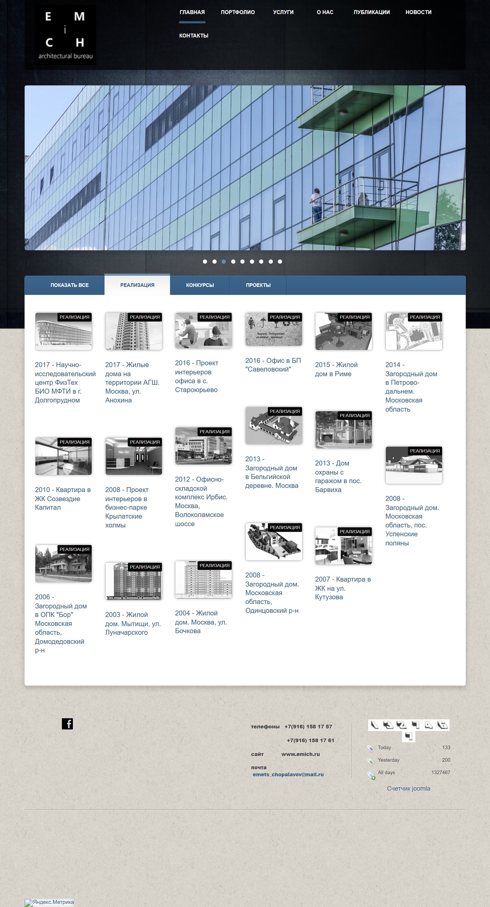

# EMICH — сайт-визитка архитектурного бюро

## 1. Название проекта

**EMICH — архитектура от идеи до реализации.**

Многоязычный статический сайт архитектурного бюро «EMICH» (Emets & Chopalavov Architecture Bureau). Проект представляет услуги бюро, профессиональный опыт, награды, значимые работы и содержит форму для подготовки обращения через почтовое приложение пользователя.



## 2. Проблема, которую решает проект

Архитектурным услугам необходимо цифровое представительство, которое одновременно:

- понятно объясняет потенциальному заказчику состав и ценность услуг;
- демонстрирует опыт, профессиональные компетенции и доверие к команде;
- показывает реализованные и текущие проекты в наглядном формате;
- позволяет быстро перейти от просмотра сайта к обсуждению задачи;
- доступно русскоязычной и международной аудитории;
- не требует сложной серверной инфраструктуры и постоянного сопровождения CMS.

Сайт заменяет разрозненные презентации и текстовые описания единой точкой входа: услуги → опыт → портфолио → контакт.

## 3. Целевая аудитория

Проект рассчитан на:

- частных заказчиков, которым нужны архитектурный проект, интерьер или сопровождение строительства;
- девелоперов и представителей организаций, рассматривающих бюро как проектировщика или эксперта;
- заказчиков общественных, исследовательских, жилых и коммерческих объектов;
- международных партнёров и архитектурные бюро, которым важны английская, французская и итальянская версии;
- посетителей, оценивающих профессиональный опыт по проектам, наградам и участию в конкурсах.

## 4. Цели сайта

1. Сформировать ясное представление о специализации бюро.
2. Показать полный цикл работ: от идеи и концепции до рабочей документации и авторского надзора.
3. Подчеркнуть BIM-компетенции в ArchiCAD и Revit.
4. Представить опыт работы над уникальными объектами и объектами наследия.
5. Подтвердить экспертность через цифры, проекты, награды и конкурсы.
6. Упростить первый контакт с бюро.
7. Обеспечить базовую поисковую оптимизацию и корректную индексацию языковых версий.

## 5. Основные разделы

### Главный экран

Содержит позиционирование бюро, краткое описание услуг и кнопку перехода к форме обращения. Визуальный акцент — изображение световой инсталляции.

### Польза для заказчика

Раскрывает шесть преимуществ:

- полный цикл проектирования;
- BIM-точность;
- более 25 лет профессиональной практики;
- международный опыт;
- работа со зданиями, интерьерами и территориями;
- экспертиза уникальных объектов.

### Доверие

Включает ключевые показатели, список наград и признаний, а также перечень значимых проектов и конкурсов.

### Проект в работе

Представляет исследовательский центр МФТИ в Долгопрудном с помощью видео и галереи изображений. Фотографии открываются в полном размере в отдельной вкладке.

### Обсуждение проекта

Содержит форму с полями «Имя», «Контакт» и «О задаче», а также контактный блок с телефоном, электронной почтой и городом.

## 6. Функциональные возможности

- четыре языка интерфейса: русский, английский, французский и итальянский;
- отдельные статические страницы `/en/`, `/fr/` и `/it/`;
- переключение языка без перезагрузки основной страницы;
- сохранение выбранного языка в `localStorage`;
- первоначальный выбор языка с учётом языковой версии страницы и настроек браузера;
- адаптивная вёрстка для экранов разной ширины;
- анимации появления блоков при прокрутке;
- анимированные числовые показатели;
- учёт системной настройки `prefers-reduced-motion`;
- видеоплеер с постером и стандартными элементами управления браузера;
- адаптивные изображения галереи через `srcset` и `sizes`;
- подготовка письма через `mailto:` без серверной обработки формы;
- автоматическое обновление года в подвале сайта.

## 7. Как работает форма

Форма не отправляет данные на сервер и не сохраняет их в базе данных.

После нажатия кнопки отправки JavaScript:

1. считывает имя, контакт и описание задачи;
2. выбирает тему письма в соответствии с текущим языком;
3. формирует ссылку `mailto:` для адреса `info@emich.ru`;
4. открывает почтовое приложение пользователя с подготовленным текстом.

Для завершения отправки пользователю необходимо подтвердить письмо в своём почтовом приложении. Если почтовое приложение не настроено, форма не сможет доставить обращение.

## 8. Технологии

Проект не требует сборки и установки зависимостей.

- **HTML5** — структура страниц, метаданные и JSON-LD.
- **CSS3** — оформление, адаптивная сетка, состояния и анимации.
- **JavaScript (ES5-совместимый синтаксис)** — переводы, форма, переключатель языка и анимации.
- **Intersection Observer API** — отслеживание появления элементов в области просмотра.
- **Google Fonts** — семейства Archivo и JetBrains Mono.
- **SVG, JPEG и MP4** — графика, фотографии и видео.

## 9. Структура проекта

```text
visit card emich/
├── index.html                       # Русская версия и основной HTML-шаблон
├── styles.css                      # Стили и адаптивная вёрстка
├── app.js                          # Переводы и интерактивность
├── robots.txt                      # Правила индексации
├── sitemap.xml                     # Карта языковых версий сайта
├── README.md                       # Описание проекта
├── 2026-10-15_deploy-checklist_doc.md
│                                   # Чеклист подготовки к развёртыванию
├── en/
│   └── index.html                  # Английская версия
├── fr/
│   └── index.html                  # Французская версия
├── it/
│   └── index.html                  # Итальянская версия
└── assets/
    ├── favicon.svg                 # Значок сайта
    ├── hero-art.jpg                # Изображение главного экрана
    ├── mfti-video.mp4              # Видео проекта
    ├── mfti-video-poster.jpg       # Постер видео
    ├── mfti-1.jpg … mfti-4.jpg     # Полноразмерные фотографии
    └── mfti-*-480.jpg              # Уменьшенные версии фотографий
```

## 10. SEO и языковые версии

В проекте предусмотрены:

- уникальные `title` и `description`;
- канонические адреса страниц;
- альтернативные ссылки `hreflang` для RU, EN, FR, IT и `x-default`;
- метаданные Open Graph и Twitter Card;
- структурированные данные Schema.org типа `ProfessionalService`;
- `robots.txt` и `sitemap.xml`;
- семантические HTML-элементы и текстовые альтернативы изображений.

В SEO-адресах используется основной домен `https://emich.ru/`. При смене домена необходимо обновить canonical, Open Graph, JSON-LD, `sitemap.xml` и `robots.txt`.

## 11. Локальный запуск

Специальная сборка не нужна. Можно открыть `index.html` в браузере или запустить локальный HTTP-сервер из каталога проекта:

```bash
python -m http.server 8000
```

После этого сайт будет доступен по адресу:

```text
http://localhost:8000/
```

Для корректной проверки маршрутов `/en/`, `/fr/` и `/it/` предпочтителен запуск через HTTP-сервер.

## 12. Развёртывание

Для публикации на статическом хостинге необходимо загрузить:

- `index.html`;
- `styles.css`;
- `app.js`;
- `robots.txt`;
- `sitemap.xml`;
- каталоги `assets/`, `en/`, `fr/` и `it/`.

`README.md` и чеклист развёртывания не требуются для работы сайта.

Подробный порядок подготовки находится в файле `2026-10-15_deploy-checklist_doc.md`.

## 13. Обязательная проверка перед публичным запуском

- Заменить телефон-заглушку `+7 (495) 000-00-00` во всех языковых версиях.
- Проверить адрес электронной почты `info@emich.ru`.
- При необходимости уточнить адрес в JSON-LD.
- Проверить актуальность описаний, цифр, наград и перечня проектов.
- Убедиться в наличии прав на публикацию фотографий, видео и упоминаний объектов.
- Проверить все ссылки, переключатели языков и отправку через почтовое приложение.
- Проверить отображение на мобильных устройствах и в основных браузерах.
- Настроить HTTPS, редирект с HTTP и предпочтительный вариант домена с `www` или без него.
- После запуска зарегистрировать сайт в поисковых панелях веб-мастеров и отправить карту сайта.

## 14. Ограничения текущей версии

- Нет серверной обработки и гарантированной доставки заявок.
- Нет CMS: тексты и переводы редактируются непосредственно в HTML и JavaScript.
- Нет автоматических тестов и процесса CI/CD.
- Для загрузки шрифтов используется внешний сервис Google Fonts.
- Видео хранится локально и увеличивает объём данных, загружаемых с хостинга.

## 15. Возможные направления развития

- серверная или сервисная обработка формы с защитой от спама;
- уведомление пользователя об успешной отправке и обработка ошибок;
- оптимизация изображений в WebP/AVIF и дополнительное сжатие видео;
- система управления контентом для самостоятельного обновления проектов;
- расширение портфолио отдельными страницами проектов;
- автоматические проверки ссылок, HTML и доступности;
- подключение аналитики после настройки уведомлений и согласий, если они потребуются.

## 16. Текущий статус

Статическая версия сайта сформирована. Репозиторий предназначен для приватного хранения исходного кода. Перед публичным развёртыванием необходимо выполнить проверку контактов, материалов и прав на их размещение.
